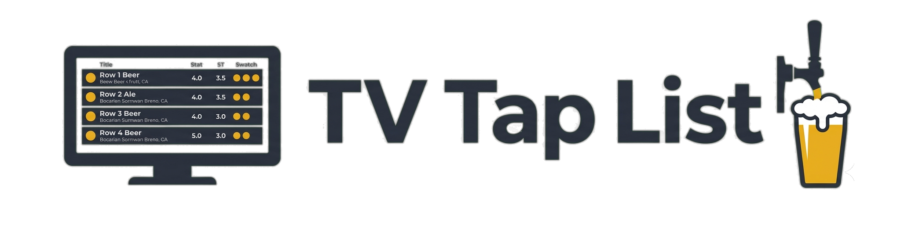
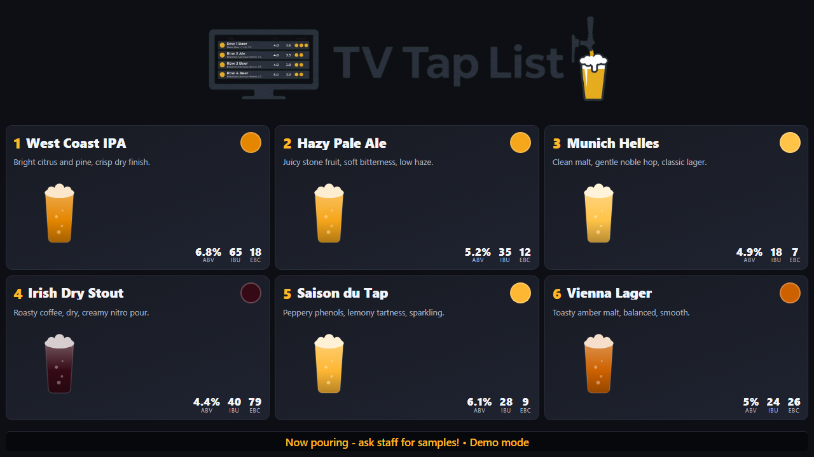

# TV Tap List

<p align="center">
  
</p>

**An offline-first digital beer tap list for TVs.** Point a TV's browser at it and
it shows a clean, full-screen board of what's on tap - name, tasting notes, ABV,
IBU, gravity, and a colour swatch matched to each beer.

It pulls your beers automatically from **[Brewfather](https://brewfather.app)** and
keeps showing the **last known board even when the internet drops** - no spinners,
no blank screen, zero outbound requests. The container is the brain; the TV is just
a screen pointed at it.



- **One container.** Python + FastAPI inside; vanilla HTML/CSS/JS on the TV. No
  cloud, no build step, no CDNs.
- **Offline-first.** Beers are cached as plain text + images in a folder you map
  from the host, so the board survives reboots and outages and stays inspectable.
- **Runs anywhere Docker does** - a Raspberry Pi, an Unraid box, a NUC, a VM.
- **A photo album between the taps.** Upload photos from a phone or a desktop into
  named albums (or drop folders on the disk), and a screen shows a few of them after
  every few pages of taps, or all the time as a photo frame. Per screen, in the Admin.
  - **Framed prints.** Each photo sits in a mount and a frame (drawn or realistic),
    after Samsung's The Frame.
  - **Portraits and captions.** Two or three portraits show side by side, and the
    date taken and album name can be set on the mount's bottom edge (off until you
    switch them on in the Photo album settings). An optional slow zoom drifts the
    photo inside its mount.
  - **Any phone photo.** HEIC, RAW and the usual formats; a compatibility mode serves
    JPEG to TVs that cannot show WebP. Photos are stripped of location data and kept
    as untouched originals on disk.

---

## Try it now (demo)

One command pulls the image and runs a self-contained demo with sample beers - no
Brewfather account, no config:

```bash
docker run -d --name tv-taplist-demo -p 8080:8080 \
  -e DEMO_MODE=true \
  ghcr.io/jceccato/tv-taplist:latest
```

- **Display:** <http://localhost:8080/> - the TV board (no login).
- **Admin:** <http://localhost:8080/admin> - open (no login) in demo mode so you can
  play with settings, themes and overrides. Set `ADMIN_PASSWORD` before exposing the
  box to anyone; a password re-enables normal login.

Stop and remove it when you're done: `docker rm -f tv-taplist-demo`.

> The demo is for evaluation only -- see [INSTALLATION.md](docs/INSTALLATION.md) for a real setup.

---

## Set it up for real

```bash
bash <(curl -fsSL https://raw.githubusercontent.com/jceccato/tv-taplist/main/setup)
```

The guided installer asks a few questions (admin password, timezone, Brewfather
details), installs Docker Compose if needed, writes the config, and starts the
container. Full env var reference, reverse-proxy/HTTPS setup, and the Brewfather API
key walkthrough: [INSTALLATION.md](docs/INSTALLATION.md).

| Path | Best for | Guide |
|------|----------|-------|
| **Guided installer** | Linux / Raspberry Pi / NUC | [INSTALLATION.md -> Guided installer](docs/INSTALLATION.md#guided-installer-recommended) |
| **Unraid** | Unraid servers | [INSTALLATION.md -> Unraid](docs/INSTALLATION.md#unraid) · [UNRAID.md](docs/UNRAID.md) |
| **Windows** | Docker Desktop on a Windows PC | [INSTALLATION.md -> Windows](docs/INSTALLATION.md#windows-docker-desktop) · [WINDOWS.md](docs/WINDOWS.md) |
| **Manual Docker Compose** | You already run Compose | [INSTALLATION.md -> Manual](docs/INSTALLATION.md#manual-docker-compose) |

---

## Getting beers onto the board

1. In Brewfather, open the batch for a beer that's on tap.
2. Add a line to the batch's **Batch Notes** field: `tap:1` (the tap number it's pouring on).
3. Set the batch **status to Completed**.

On its next sync the board picks it up. You can fine-tune the swatch colour,
glassware and more with extra note tokens or from the admin panel - see
[FAQ.md -> Brewfather](docs/FAQ.md#brewfather-sync). Beers that aren't Completed are
ignored by default, so works-in-progress never show up by accident - though you can
opt to include **Conditioning** (lagering / maturing) or **Fermenting** (primary)
batches from the admin.

---

## Display on a screen

Once the container is running, you need a device that loads `/` in a full-screen
browser and keeps it there. Two supported paths:

| Path | Best for | Guide |
|------|----------|-------|
| **Raspberry Pi** | Dedicated, always-on Pi plugged into the TV via HDMI | [RASPBERRY_PI_KIOSK.md](docs/RASPBERRY_PI_KIOSK.md) |
| **Android device** | Phone, tablet, Android TV, Chromecast, Fire Stick -- no Pi needed | [ANDROID_KIOSK.md](docs/ANDROID_KIOSK.md) |

Both set up a kiosk that launches the board on boot and stays full-screen with
no user interaction.

### Different screens, different settings (Display profiles)

One box can run screens that behave differently: say a tap-side tablet that
shows only what is on tap, and a lounge TV that pages differently or wears its
own theme. Make a **Display profile** for each kind of screen in the Admin, then
point each screen at its own by adding `?display=<name>` to its kiosk start URL,
for example `http://<container-ip>:8080/?display=lounge-tv`.

Your existing settings become the **Default profile**. Every other profile
follows it and differs only in the settings you switch to **Customise**, so a
screen with no `?display=` (or an unknown name) shows the Default profile.
The Raspberry Pi installer asks for the profile name and writes the URL for you;
the Android guide shows where to put it. Profile names are lowercase letters,
digits and hyphens, up to 32 characters.

In the Admin each profile shows its start URL with a **Copy** button, so you can
open the Admin on the device (or send the URL to it) instead of typing on a TV
remote. A screen that asks for a name the Admin does not know shows the Default
profile, and the Admin lists that name under **Unknown profile names** until the
next restart, so a typo is easy to spot. Renaming a profile breaks any start URL
that used the old name (those screens show the Default profile), so the Admin
asks before it renames.

Some smart-TV browsers (LG webOS, Samsung Tizen, Fire TV) mark themselves, so a
profile can also be picked without a URL parameter: in the profile editor, fill
in **Also use for screens whose User-Agent contains** (plain text, any case).
`?display=` always wins over it, and when several profiles match, the first one
in the list is used (the Admin warns about the clash). Android TV and tablet
kiosks send a generic User-Agent, so they still need the URL. The Admin's
**Recently seen screens** list shows each screen's User-Agent, the profile it
got and how, so you can copy a token from a real screen. It is kept in memory
and starts empty after a restart.

---

## How it works

A short tour: the container syncs from Brewfather on a timer, resolves each tap to
a beer, computes its colour, and serves a board the TV polls and updates in place.
Manual overrides let you place beers Brewfather doesn't know about. Everything
persistent is plain text in a folder you can open.

The full explanation - sync, colours and themes, glassware, pagination, the offline
guarantee, archiving, and security - is in **[FAQ.md](docs/FAQ.md)**.

---

## Guides

- **[INSTALLATION.md](docs/INSTALLATION.md)** - set it up: demo, guided installer,
  Unraid, manual Compose, env vars, reverse proxy, Brewfather API key.
- **[FAQ.md](docs/FAQ.md)** - how everything works, in depth.
- **[UNRAID.md](docs/UNRAID.md)** - the deep-dive Unraid walkthrough.
- **[WINDOWS.md](docs/WINDOWS.md)** - Docker Desktop on Windows: the data
  directory, verifying it persists, PUID/PGID, WSL2, and LAN access.
- **[RASPBERRY_PI_KIOSK.md](docs/RASPBERRY_PI_KIOSK.md)** - turn a Raspberry Pi into a
  dedicated kiosk display.
- **[ANDROID_KIOSK.md](docs/ANDROID_KIOSK.md)** - use an Android tablet, TV,
  Chromecast or Fire Stick as a kiosk display.
- **[CHANGELOG.md](CHANGELOG.md)** - what changed in each release.
- **[BUILDING.md](docs/BUILDING.md)** - build from source (development, customisation,
  or architectures without a prebuilt image).

## License

AGPLv3. See [LICENSE](LICENSE). In short: you may use, modify, and redistribute
this software, but if you offer a network-accessible service based on it, you
must also make the source code (including your changes) available to its users.
